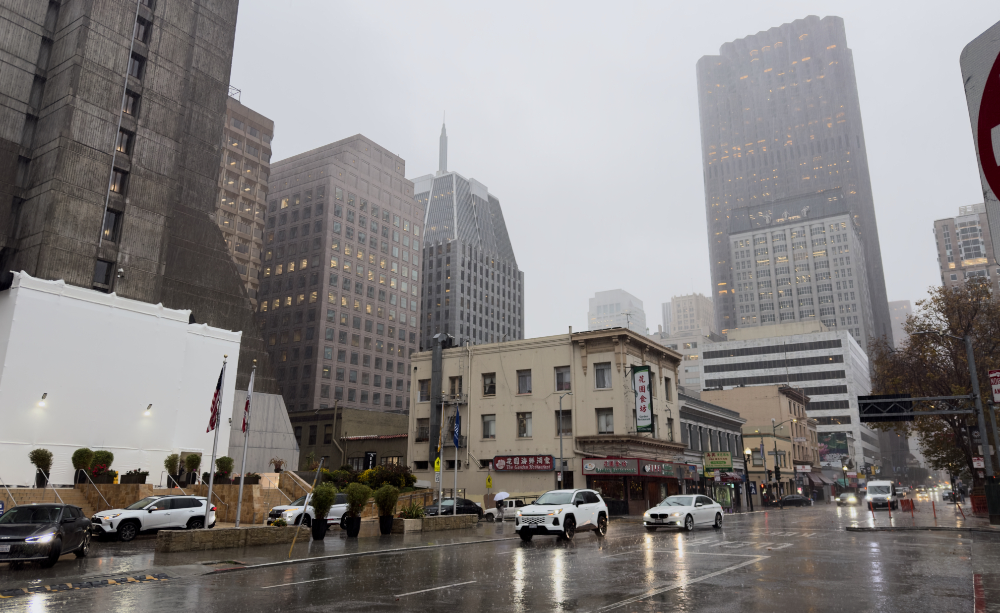

- It's rainy out! If you're in the Bay Area, stay safe!

It has been brought to my attention by keen-eyed readers that I’ve spent the last week referring to Additive Friendship Mindset™️, but [last week](https://rwblickhan.org/newsletters/the-benefit-of-living-in-a-major-metropolitan-area-is-that-theres-so-many-people/) I failed to sufficiently define what exactly I meant. So, let’s try again.

An Additive Friendship Mindset™️ is when you’re intentionally trying to add new friends. You make an effort to go to new events that you might not otherwise. You go to parties where you don’t know everyone already — and, when you do know people, you try to talk to someone new. You don’t just assume that a conversation is a way to pass time, but instead treat it as if it’s the first conversation in a longer relationship, and perhaps have deeper conversations as a result. When hosting, you make an effort to include people you might not otherwise, people that you may have tenuous connections to but would be interested in being closer to.

Which... might seem obvious. But it’s surprisingly easy to simply coast, to feel like your social circle is in some sense “complete,” that new additions will be more-or-less by accident. So it feels useful to have an explicit mindset of “I am going to try to put myself out there,” even if you feel nothing is missing.

Again, this is intended as an _additive_ mindset — not to replace any existing friends. Perhaps you fall into it because you feel something missing in your current social circle; perhaps you adopt it because drama has made your current social circle untenable; perhaps you simply realize it’s been too long since you’ve talked to someone new. But, in any case, there’s a strong emphasis on the _additivity_.

---

Do these missives feel short? Aren’t you shaking your screen, saying “Russell, you’re missing history! A robot saved the Riemann hypothesis! The entire knowledge work economy might be a footnote to Anthropic’s earnings call in just a few years! Don’t you have a comment!”[^hypothesis] And... well. Mostly, I am just busy, for reasons that will become obvious (I promise) in just a few weeks. But, more importantly, even in the greatest of upheavals, there is mundanity. And, really, from my perspective, what is there to say? The future will either happen, or it won’t. We’ll be borne along (...boats against the current...) and we shall see what happens. In the meantime discussing the vagaries of my immediate social circle seems more pressing. Which, perhaps, aligns with my humanist underpinnings.

[^hypothesis]: Ironically, it seems like the robot may have been nearly scooped... by a _human_.
