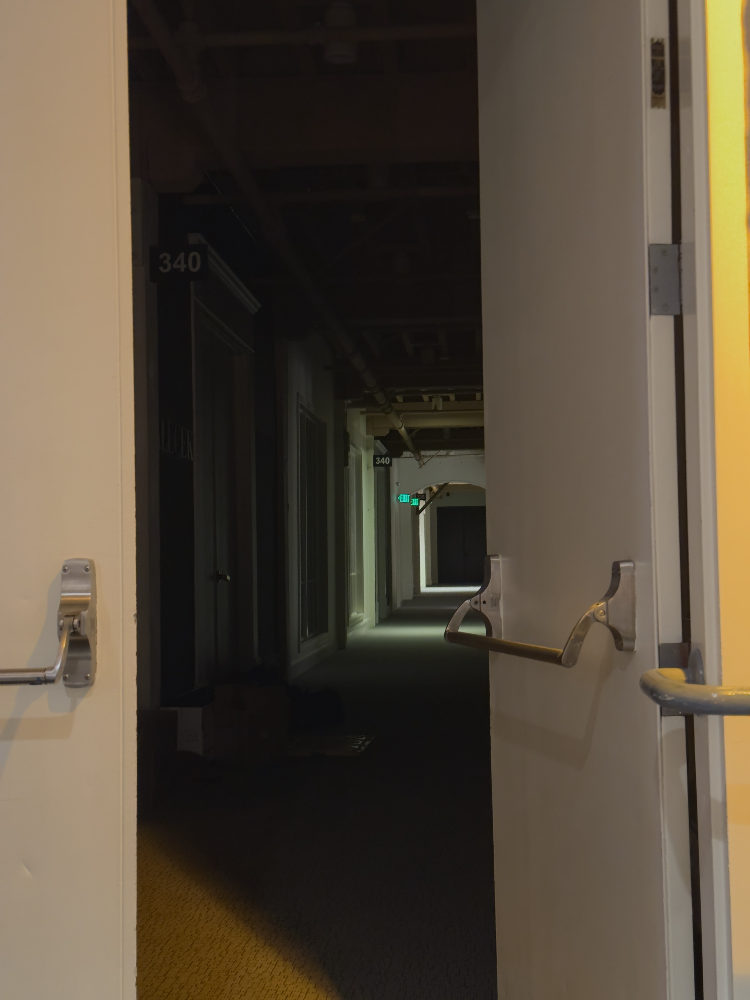

- A slightly spooky hallway I spotted in the San Francisco Design Center, which definitely doesn't lead to [the Backrooms](https://en.wikipedia.org/wiki/The_Backrooms). Then again, the Design Center also a massive sign for [Phillip Jeffries](https://www.phillipjeffries.com/), a name that will be [familiar to fans of _Twin Peaks_](https://en.wikipedia.org/wiki/Phillip_Jeffries)...

The interesting thing about having an (admittedly mild) mental illness is that it’s often difficult to introspect on one’s own emotional state. One may know they are not “all right,” yet remain mystified as to the root cause. Is it stress or anxiety for obvious reasons? Is it dissatisfaction over something one can’t quite intuit about oneself? Is it simply dehydration from a heat wave? Or is the low-level sadness just, as it usually is, an unfortunate quirk of biochemistry?

And the question becomes more urgent the longer it stretches on. If there is a problem, it can be fixed, and if not, experience says the feeling eventually passes, and usually quickly.[^mild] But then there’s a problem of induction — experience says the Sun will rise again tomorrow, but what if it doesn’t? What if this time the feeling sticks?

[^mild]: One of those reasons it is, admittedly, mild.
