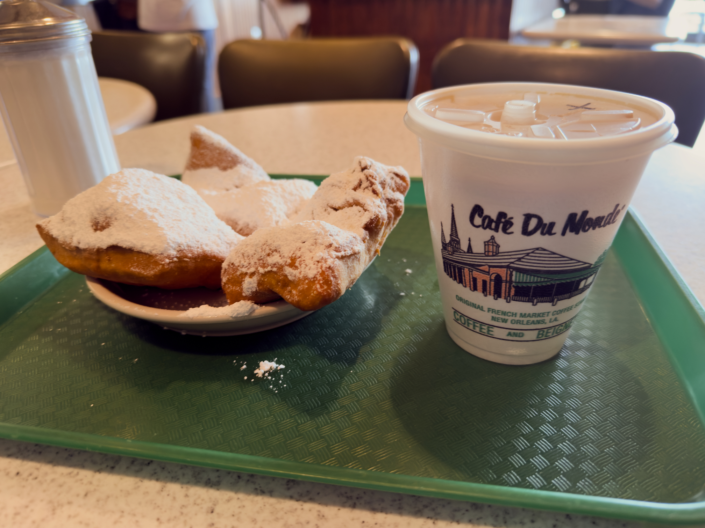

- What trip to New Orleans would be complete with a cafe au lait and beignets at Café du Monde?

So one thing I’ve been thinking about recently is friendship.

There’s a widespread belief that making friends in your 30s is notoriously difficult. You’re more settled, you’re more focused on your existing friends, you might have young children absorbing your time.[^children] And that’s all true — but I wonder if the mindset itself is part of the problem.

In [_Before Sunset_](https://letterboxd.com/film/before-sunset/)[^sunset], there’s a pretty famous line that goes:

> I guess when you’re young, you just believe there will be many people with whom you’ll connect with. And later in life, you realize it only happens a few times.

In the context of the film, it’s specifically about romantic love, but being spoken by a woman in her early 30s, it’s easy to read it as a comment on _all_ kinds of relationships, friendships included. Hang on to your cherished connections, because you probably won’t make new ones.

So, for instance, when I go to a party now, I don’t expect to make any new friends. Usually, if it’s a party where I don’t already know everybody, I assume I’ll have a few light conversations (possibly interesting, possibly not) and then never see those people again.

But... I don’t think that’s actually true.[^friends] I _did_ meet the majority of my current friends at random parties, or through friends-of-friends that I did meet at parties, and some of my closest friends are relatively recent (even within the past two years or so). Maybe you only connect with a few people per capita — but the benefit of living in a major metropolitan area is that there’s so many people! Even at a low rate of connection, if you put yourself out there, you’ll connect with people!

So maybe I just need a new mindset. Next time I go to a party, maybe I need to think _this person might be my new best friend_.[^best] And... probably, they won’t be. But you never know!

[^children]: Though, when/if I have children, I’m hoping to have a more [unattached parenting style](https://www.nytimes.com/2024/09/15/opinion/parenting-helicopter-ignoring.html?unlocked_article_code=1.NVE.1zVB.TPYN9sAGdXRo). Kids can deal with being bored! Kids can deal with watching their parents interact with their friends! Your life doesn’t have to revolve around your children!

[^sunset]: A trilogy I have complicated feelings about, but perhaps more on that another time!

[^friends]: Ironically, in the last film of the trilogy, _they have a whole new set of friends_.

[^best]: One of my friends has a habit of joking about needing new friends. He’s intensely social and has something like a dozen major friend groups, not to mention his extremely large extended family — so he intends it as an _addition_, not a replacement. Still, my social circle clowns on him for wanting to replace all of us. In that spirit, let it be said that this statement does _not_ mean that I’m looking to replace anyone — quite to the contrary. The point of this essay is more that I _need_ more of an additive mindset — that I can accept new people into my life without necessarily impacting any existing relationships.
